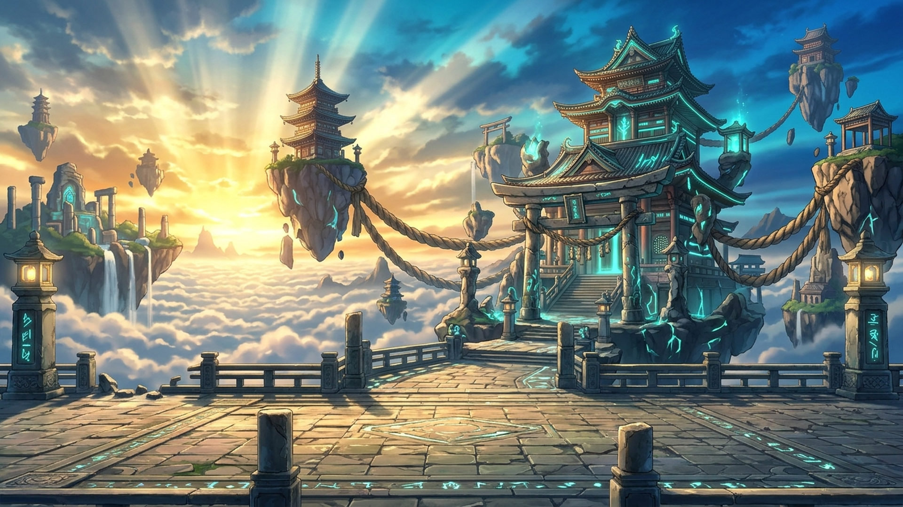

# ⚔️ Apex Brawl: Mystic Kombat

<div align="center">



[](https://www.electronjs.org/)
[](https://phaser.io/)
[](https://github.com/websockets/ws)
[]()
[](LICENSE)

**A high-octane, competitive 2D fighting game crafted with Electron, Phaser 3, and modern Web technologies.**  
*Combines arcade frame-precision, cinematic supers, local and LAN multiplayer, and a seamless QR-powered mobile controller.*

[Features](#-key-features) • [Fighter Roster](#-fighter-roster) • [Controls](#-controls--input) • [Game Modes](#-game-modes) • [Architecture](#-architecture) • [Getting Started](#-getting-started)

</div>

---

## 🌟 Key Features

- **⚡ Frame-Accurate Combat Engine**
  - Explicit frame phases: Startup, Active, and Recovery.
  - Interactive hitboxes and hurtboxes toggleable on the fly (`H`).
  - Blockstun, hitstun, pushback dynamics, wallbounces, and juggle decay.
  - Gatling cancel routes (`Light ➔ Medium ➔ Heavy ➔ Special ➔ Super`).
- **🔥 3-Stock Ki Super & Ultimate System**
  - Build meter dynamically through aggressive strikes and well-timed guards.
  - Spend Ki on game-changing Supers and screen-shattering cinematic Ultimates.
- **🌐 Seamless LAN Multiplayer & Mobile Controller**
  - **Local Area Network (LAN)**: Host and join matches over your Wi-Fi/LAN network using low-latency WebSockets with zero external servers required.
  - **Mobile Gamepad Pairing**: Scan an on-screen QR code with your smartphone to turn your phone into a low-latency touch gamepad controller.
- **🤖 Adaptive Fighting AI**
  - Fight against CPU combatants featuring distinct difficulty tiers (`EASY`, `MEDIUM`, `HARD`, `APEX`).
  - Intelligent neutral game, anti-air reactions, projectile counter-play, and combo execution.
- **🥋 Dedicated Training Mode & The Grimoire**
  - Live combo telemetry, damage scaling display, position reset, and frame data inspection.
  - Integrated in-game **Grimoire** detailing move lists, framedata, on-block advantages, and character lore.
- **🎵 Dynamic Audio Engine & Cinematic Presentation**
  - Custom Web Audio synthesizer alongside sampled soundscapes, impact bass, whooshes, and fight announcer voices.
  - Mortal Kombat-style dynamic VS splash screen with fighter match-up cards, quotes, and pro tips.

---

## 👥 Fighter Roster

Apex Brawl features an eclectic 6-fighter roster plus a specialized combat automaton:

| Fighter | Archetype | Signature Move | Ultimate Art |
| :--- | :--- | :--- | :--- |
| **Roronoa Zoro** | Striker / Mid-Range Slash | *360 Pound Cannon* | **Santoryu Ougi: Demon Slash Oni Giri** |
| **Doctor Strange** | Zoner / Spellcaster Supreme | *Mystic Orb* | **Mirror Dimension Shatter** |
| **Chun-Li** | Rushdown / Lightning Striker | *Hyakuretsukyaku* | **Hoyoku-sen: Phoenix Flurry** |
| **Mewtwo** | Zoner / Psychic Overlord | *Shadow Ball* | **Psystrike Supernova** |
| **Harpy** | Aerial Rushdown / Dive Striker | *Dive Kick (8C)* | **Tempest Carnage** |
| **Steve** | Brawler / Trap Specialist | *TNT Toss* | **Diamond Blade Overdrive** |
| **Training Dummy** | Automaton / Practice Target | *Telemetry Response* | *Diagnostic Burst* |

---

## 🎮 Controls & Input

The game supports two local players on a single keyboard, dual gamepads, or paired mobile controllers.

### Keyboard Mappings

| Action | Player 1 (WASD) | Player 2 (Arrow Keys) |
| :--- | :--- | :--- |
| **Move / Jump / Crouch** | `W`, `A`, `S`, `D` | `↑`, `←`, `↓`, `→` |
| **Light Attack (5A)** | `F` | `J` / `Numpad 1` |
| **Medium Attack (5B)** | `G` | `K` / `Numpad 2` |
| **Heavy Attack (5C)** | `H` | `L` / `Numpad 3` |
| **Special Projectile / Move** | `R` | `U` / `Numpad 4` |
| **Super / Ultimate (Ki 1-3)** | `Y` *(or `S + H`)* | `I` *(or `↓ + L`)* |
| **Dash** | `Q` | `O` / `Numpad 5` |
| **Taunt** | `T` | `P` / `Numpad 0` |

### System & Training Shortcuts

- **`ESC`**: Pause match / Open match menu
- **`H`**: Toggle visible real-time Hitboxes (Red) & Hurtboxes (Blue/Green)
- **`F11`**: Toggle Fullscreen mode

---

## 🕹️ Game Modes

1. **Local Versus (1P vs 2P)**  
   Head-to-head competitive local fight on a single system or with connected gamepads.
2. **Arcade / CPU Battle (1P vs AI)**  
   Select any fighter and test your skills against our custom behavioral AI with customizable difficulty.
3. **LAN Multiplayer (Host / Join)**  
   Host a lobby on your local network. Friends on the same network can automatically discover your lobby or join directly using the host's LAN IP address.
4. **Mobile Controller Companion**  
   The built-in HTTP server hosts a web-based gamepad on port `3000`. Scan the QR code in the lobby with any mobile phone on the same Wi-Fi network to play wirelessly without installing any apps!
5. **Training Arena**  
   Infinite health and Ki stock, real-time input telemetry, hitbox visualization, and instant position resetting for labbing combos and frame traps.
6. **The Grimoire**  
   Complete move manual, input charts, startup/active/recovery frame counts, and safety on block.

---

## 📁 Architecture & Project Structure

```
Apex_Brawl/
├── assets/                       # Root game assets (audio, characters, backgrounds)
│   ├── backgrounds/              # High-resolution battle arenas (Sky Temple, Japanese Temple)
│   └── characters/               # Character spritesheets, avatars, and action renders
├── grimoire/                     # Character framedata & moveset JSON definitions
│   ├── chunli.json
│   ├── doctor_strange.json
│   ├── harpy.json
│   ├── mewtwo.json
│   ├── steve.json
│   └── roster.json
├── src/
│   ├── main/                     # Electron Main Process
│   │   ├── main.js               # App lifecycle, BrowserWindow, IPC handlers
│   │   ├── preload.js            # Secure contextBridge IPC bridge
│   │   ├── lanServer.js          # WebSocket LAN lobby & host/client netcode
│   │   └── mobileServer.js       # Embedded HTTP & WebSocket server for phone gamepads
│   ├── mobile/                   # Phone Virtual Gamepad Web Client
│   │   └── index.html            # Responsive touchscreen D-Pad & battle buttons
│   └── renderer/                 # Phaser 3 Game Engine & DOM UI Layer
│       ├── index.html            # Main UI shell (Menus, Grimoire, VS Screen, LAN Modals)
│       ├── arena.js              # Core Phaser Combat Scene (Rendering, VFX, Camera, HUD)
│       ├── CombatSystem.js       # Frame-accurate combat rules, cancels, and hit detection
│       ├── PhysicsEngine.js      # 2D platform physics, gravity, friction, wallbounces
│       ├── StageCamera.js        # Dynamic cinematic zoom, panning, and hit screen-shake
│       ├── fightingAI.js         # Adaptive CPU artificial intelligence
│       ├── lanManager.js         # Client-side network synchronization & input buffer
│       ├── audio.js              # Web Audio API procedural & sampled sound manager
│       ├── loading.js            # Cinematic match intro & VS splash screen
│       ├── menu.js               # Character select, stage select, and menu transitions
│       ├── config.js             # Phaser configuration constants
│       └── styles/               # CSS UI stylesheets (menu, VS screen, training HUD)
├── package.json
└── README.md
```

---

## 🚀 Getting Started

### Prerequisites

- [Node.js](https://nodejs.org/) (v18.0.0 or higher recommended)
- `npm` (bundled with Node.js)

### Installation

1. Clone the repository:
   ```bash
   git clone https://github.com/adarshnotfound/Apex_Brawl.git
   cd Apex_Brawl
   ```

2. Install dependencies:
   ```bash
   npm install
   ```

3. Launch the game:
   ```bash
   npm start
   ```

### 📦 Building the Windows Executable / Installer

- **Full Windows Setup Installer (NSIS)**:
  ```bash
  npm run dist
  ```
  Generates `Apex Brawl Setup <version>.exe` inside the `dist/` directory.

- **Standalone Portable Executable**:
  ```bash
  npm run dist:portable
  ```
  Generates a single standalone `.exe` inside `dist/`.

---

## 📱 Using Your Phone as a Gamepad

1. Ensure your PC and mobile device are connected to the same Wi-Fi network.
2. Launch Apex Brawl and open the **LAN / Controller** modal in the main menu.
3. Scan the displayed QR code with your mobile camera or navigate directly to:
   ```
   http://<YOUR_PC_LOCAL_IP>:3000
   ```
4. The virtual gamepad will automatically pair via WebSocket, allowing you to control Player 1 or Player 2 from your phone!

---

## 🛠️ Built With

- **[Electron](https://www.electronjs.org/)** - Desktop application runtime
- **[Phaser 3](https://phaser.io/)** - Fast, robust 2D WebGL/Canvas game framework
- **[ws](https://github.com/websockets/ws)** - High-performance WebSocket server for LAN and mobile input
- **[qrcode](https://www.npmjs.com/package/qrcode)** - QR generation for zero-friction mobile gamepad pairing
- **Web Audio API** - Dynamic procedural synthesizer and low-latency audio mixer

---

## 📜 License

This project is licensed under the MIT License — see the [LICENSE](LICENSE) file for details.

---

<div align="center">
  <sub>Developed for Softablitz 2026. Made with passion for fighting game enthusiasts.</sub>
</div>
